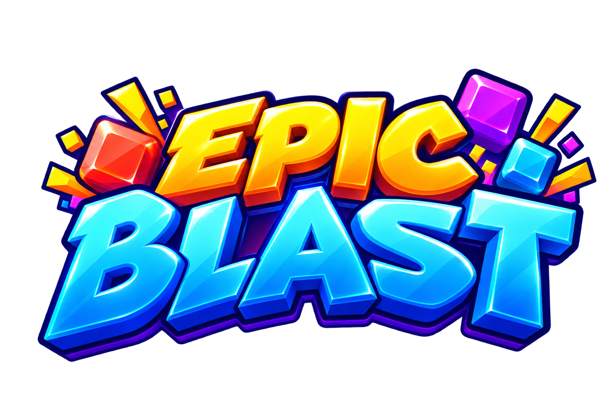
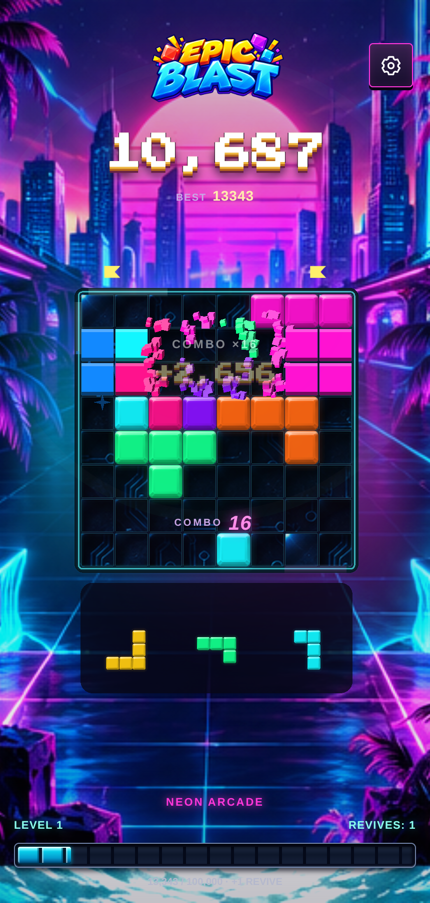
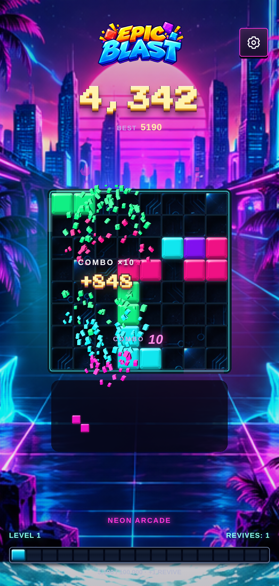
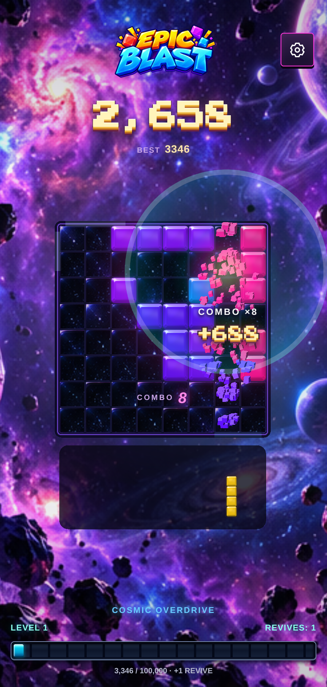

<p align="center">
  
</p>

# EPIC BLAST

A Block Blast–style puzzle game for the browser, built with **TypeScript**, **Pixi.js 7** and **Vite**. You drag pieces onto an 8×8 board and clear full rows and columns. It has neon "jewel" blocks, nine themed worlds, a combo system, revives, a recorded stadium announcer and background music. It installs as a PWA.

<p align="center">
  
  
  
</p>

---

## How to play

- The board is an **8×8 grid**. Each round deals **three pieces** into the tray below it.
- Drag a piece onto the board. Pieces **never rotate**. While you drag, the piece floats above your finger or cursor, a ghost shows where it will land, and any rows or columns it would complete start pulsing.
- A full row or column clears. Rows and columns clear **at the same time**, so one drop can clear a cross of lines.
- When all three pieces are placed, a new round is dealt.
- The game ends when none of the remaining pieces fits anywhere on the board.

### Scoring

| Event | Points |
| --- | --- |
| Placing a piece | 1 per block in the piece |
| Clearing lines | `lines × 8 × (10 × combo + 6)` |
| All clear (board empty after a clear) | +300 bonus |

**Combo** goes up by one for every move that clears at least one line. If a whole round (three pieces) passes without a clear, the combo resets to 0. Three pips beside the combo show how many pieces are left to keep it (green once the round has a clear). Your best score is saved in the browser, and the game in progress is saved after every move: closing or reloading the page continues where you left off.

### Levels and revives

- Levels are based on score, and each level needs twice as many extra points as the one before: Level 2 at 10,000, Level 3 at 30,000, Level 4 at 70,000, Level 5 at 150,000, and so on.
- You start every game with **1 revive** and earn **+1 revive per level-up**.
- **Revive after game over:** a revive deals three new pieces that are guaranteed to clear a line, and keeps your combo.
- **Save your combo:** if your combo is **10 or higher** and a round ends with no clear, the game offers to spend a revive to keep the combo going ("KOMBO RETTEN").

### Worlds

The look changes every **40 cleared lines**, independent of score level. There are nine worlds, each with its own colors and board material:

1. Neon Arcade (circuit)
2. Candy Reactor (candy)
3. Spring Bloom (leaf)
4. Summer Splash (ice)
5. Autumn Ember (wood)
6. Frozen Aurora (ice)
7. Dungeon Loot (rune)
8. Cosmic Overdrive (star)
9. Volcanic Core (lava)

After world 9 the cycle starts over as **"ECLIPSE 1"**, "ECLIPSE 2", and so on, with each world's two main colors swapped. Within a world, the theme also steps through four stages as you get closer to the next world.

### Pieces

There are 37 fixed shapes, each spawned with its own weight: dot; dominoes; straight lines of 3, 4 and 5 (horizontal and vertical); 2×2 and 3×3 squares; small and large corners; L, T, S and Z shapes; and two-cell diagonals.

Dealing is mostly random, with some help built in:
- The first piece of each round is re-rolled (up to 20 times) to try to find one that fits.
- **Helpful dealer:** the game sometimes searches one or two moves ahead and deals a piece that can clear a line. It helps more in the first four rounds of a game and on tight boards (36+ blocks, where the cooldown is skipped), and less in between.
- **Fair deals:** random trays are re-dealt (up to 12 times) until all three pieces can be placed in some order.
- **Gold jewels:** about 6% of random pieces carry a gold jewel on one block. Clearing it pays the clear's points again (at least 250).
- **First game:** the very first game starts on a prepared board where the first piece clears two lines and empties the board, with an animated hand showing the drag.

### World collection

Worlds unlock for good, across games: by reaching them in a game, or once enough lines are cleared in total (the n-th world needs n × 40 lines). Tapping the world name below the board opens the gallery, where an unlocked world can be chosen to open every new game. The game over screen shows the nearest goals (the record, the next world, the next level) and a few numbers from the game.

### Celebrations

Banners appear for special moves. Only one is shown per move, picked by priority, and each banner has a 6.5-second cooldown:

| Banner | Trigger |
| --- | --- |
| PERFECT ROUND! | All three pieces placed and the board is empty |
| CLEAN SWEEP! | A clear empties the board |
| BRILLIANT MOVE! | Your round matched the solver's optimal result |
| PHEW! CLOSE ONE! | You cleared a line when only one legal move was left |
| NEW PERSONAL BEST! | First time this game beats your best score |
| BLOCKBUSTER! | 4+ lines in one move |
| LEGENDARY! / UNSTOPPABLE! / ON FIRE! | Combo reaches 10 / 5 / 3 |
| WHAT A FINISH! | The last piece of a round clears 2+ lines after a round with no clears so far |
| IN THE ZONE! | Every 5 rounds in a row that each had a clear |
| CROSS STRIKE! | A row and a column cleared together |
| TRIPLE HIT! | Exactly 3 lines in one move |
| ROOM TO BREATHE! | A clear made with ≤3 legal moves left opens up ≥12 |

For **Brilliant Move**, a Web Worker searches every position and order for the current three pieces. It ranks results by pieces placed, then lines cleared, then empty cells and adjacent empty pairs. The solver only feeds this celebration and never changes the game state. If the search isn't finished, or workers aren't available, the celebration is skipped.

### Options

The gear button opens the options menu (labels are in German):
- **Vollbild** – fullscreen, shown only if the browser supports it
- **Sound** – sound effects and announcer on or off
- **Hintergrundmusik** – background music on or off
- **Vibration** – a short vibration on each line clear, on devices that support it
- **Visuelle Effekte** – full or reduced effects. Reduced is the default when the OS asks for reduced motion.
- **Neues Spiel** – restart, after a confirmation prompt

All settings are saved in `localStorage`. The game still works if storage is blocked.

---

## Audio

- **Sound effects** are made in code with the Web Audio API: pickup, drop impact, line-clear chords that rise with combo, fanfares, game over, new record and revive.
- **Announcer:** seven recorded calls in `src/assets/audio/announcer/` (`triple`, `unstoppable`, `legendary`, `record`, `level`, `revive`, `over`). There are at least 6.5 seconds between calls, and "Unstoppable" can repeat at most every 45 seconds. Background music gets quieter while the announcer speaks.
- **Music:** one looping track (`src/assets/audio/music/smth-smth.mp3`) with its own on/off setting. It starts after your first click or tap, because browsers block autoplay.
- Audio pauses when the tab is hidden.

## Visuals

Pixi.js draws the board, the tray, the jewel-style block textures and the per-world board materials. Effects include shatter particles (up to 450 at a time), placement puffs, screen shake, floating text and score counters that fly into the score display. The DOM layer adds impact rings, clear beams and a background that changes with your combo (calm, warm, hot, legend).

---

## Getting started

Requires **Node.js 22.18+**, which can run the TypeScript tests directly.

```bash
npm install
npm run dev        # dev server at http://localhost:3000
npm run build      # typecheck + production build into dist/
npm run preview    # serve dist/
```

| Command | What it does |
| --- | --- |
| `npm test` | Typecheck + unit tests (`tests/unit`, Node's built-in test runner) |
| `npm run test:build` | Production build, then checks the service worker, manifest and assets |
| `npm run test:e2e` | Playwright tests on desktop and mobile screen sizes |
| `npm run test:all` | All of the above |

To run one test file: `node --test tests/unit/session.test.ts`

---

## Project structure

```
index.html              Page shell: header, scoreboard, game over screen, options and combo-save dialogs
src/
  main.ts               Starts the audio engine and the game; registers the service worker (production only)
  core/                 Game rules only (no DOM, no Pixi)
    board.ts            8×8 grid, placement, line detection, clear preview
    shapes.ts           The 37 shapes and weighted random picking
    session.ts          GameSession: rounds, combo, scoring, levels, revives, combo save, celebrations
    scoring.ts          Clear score formula, all-clear bonus
    progression.ts      Level thresholds and world progress (40 lines per world)
    streak-recovery.ts  When a combo can be saved (combo ≥ 25)
  ai/
    solver.ts           Bitmask board model and exhaustive round solver
    solver.worker.ts    Runs the solver in a Web Worker
    round-predictor.ts  Starts and cancels the worker for each round
    helpful-dealer.ts   Occasional helpful piece deals
    revive.ts           Picks revive pieces that guarantee a clear
  game/game.ts          Connects GameSession to rendering, audio, haptics and the page
  render/               Pixi board, tray, textures, materials, particles, shake, floating text,
                        plus Pixi-free layout and drag math
  audio/                Sound effects engine, announcer, background music
  ui/                   Page UI: HUD, options menu, celebrations, score animation, effects, theme colors
  theme/themes.ts       The nine worlds and palette generation
  platform/             Safe localStorage, haptics, PWA registration
  styles/main.css
  assets/               Images, font (Press Start 2P), announcer clips, music
public/                 Manifest, PWA icons, favicon, install screenshots (copied as-is; regenerate with tools/generate_icons.py)
build/                  Vite PWA plugin and service worker template
tests/
  unit/                 Unit tests for rules, solver, audio, rendering math, platform code
  build/                Checks on the production build
  e2e/                  Playwright browser tests (with small test pages in harness/)
tools/                  Promo + icon generators, voice clip tools
design/                 Source material that doesn't ship (voice takes, prompts, references)
marketing/promo_images/ Promo images (1280×720, 1280×550, 512×512, 512×384, 200×120)
```

Game rules go in `core/` and are tested there. `game/game.ts` only turns the results that `GameSession` returns into visuals and sound.

---

## PWA and offline

Production builds include a web app manifest, icons and a service worker that saves all app files for offline use. The service worker is not used in dev mode.

- `sw.js` and its cache version are generated from a hash of the build output, so a changed build always gets a new cache.
- Update checks run on page load, when you return to the tab and when the connection comes back. A new version waits until all game tabs are closed, so a game in progress is never interrupted.
- Deploy all of `dist/` at once. Serve `sw.js`, `index.html` and `manifest.webmanifest` with `Cache-Control: no-cache`. Hashed files in `assets/` can be cached for a year with `immutable`.

---

## Deployment

`.github/workflows/deploy-ftp.yml` runs on every push to `main` (and by hand under **Actions → Deploy to FTP → Run workflow**). It runs `npm test`, builds `dist/` and uploads it with lftp. `index.html`, `sw.js` and `manifest.webmanifest` go up last, so visitors never load a page whose assets are still missing.

All values go under **Settings → Secrets and variables → Actions**. That page has two tabs, and each value must be in the right one. The workflow reads secrets only from the **Secrets** tab and variables only from the **Variables** tab. A value in the wrong tab counts as not set.

**Tab "Secrets" → "New repository secret"** (hidden in logs):

| Name | Required | Meaning |
| --- | --- | --- |
| `FTP_HOST` | yes | Server name, e.g. `ftp.example.com` (no `ftp://`) |
| `FTP_USER` | yes | Login name |
| `FTP_PASSWORD` | yes | Password |

**Tab "Variables" → "New repository variable"** (visible in logs):

| Name | Required | Meaning |
| --- | --- | --- |
| `FTP_REMOTE_DIR` | yes | Target folder on the server, e.g. `/htdocs/epic-blast`. Created if missing |
| `FTP_PROTOCOL` | no | `ftps` (default, FTP with TLS), `ftp` (unencrypted) or `sftp` |
| `FTP_PORT` | no | Only if the server doesn't use the default port (21 for FTP/FTPS, 22 for SFTP) |
| `FTP_DELETE_STALE` | no | `true` deletes files in `FTP_REMOTE_DIR` that are not in the build (old hashed assets). `.htaccess` and `.well-known/` are kept. Default `false` |

Use repository secrets and variables, not environment ones. The job doesn't use a GitHub environment, so it can't see values stored there. If a run fails with `FTP_… is not set`, check that the value is in the right tab.

Only turn on `FTP_DELETE_STALE` when `FTP_REMOTE_DIR` holds nothing but the game.
